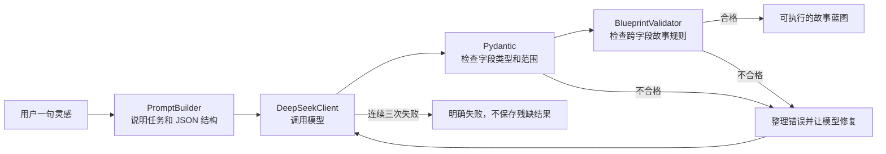

# SceneChoice M1 学习复盘与验收

> 当前状态：代码完成，个人掌握待验收。

## 1. M1 到底解决了什么

用户只说一句“新人主播误开麦后被恶意剪辑”，大模型可能返回任何格式，也可能漏集数、写出不存在的角色、给出永远无法触发的结局。

M1 的任务不是“让 AI 写故事”，而是把不稳定的大模型装进一个可靠的软件流程：



## 2. 用餐厅理解四个核心部件

把 SceneChoice 想成一家只接受“套餐订单”的餐厅：

- Prompt 像菜单和点餐要求：告诉厨师必须做三道菜、每道菜有什么；
- DeepSeek 像厨师：很有创造力，但偶尔会漏菜或自由发挥；
- Pydantic 像出餐清单：检查是不是三道菜、数量是不是数字、必填项有没有；
- BlueprintValidator 像店长：即使三盘菜都端出来了，还要检查是否全是主食、有没有客人过敏的食材、套餐能不能真正吃完。

所以 Pydantic 与业务校验不重复：前者检查“形状”，后者检查“道理”。

## 3. 只需要先读懂这四个文件

1. `scenechoice/app/schemas/story_blueprint.py`
   - 规定蓝图允许有哪些字段、数量和范围；
   - 重点看 `StoryBlueprint`、`EpisodeBlueprint`、`ChoiceBlueprint`。
2. `scenechoice/app/services/blueprint_validator.py`
   - 检查重复 ID、错误引用、相同选择、终集未收束和不可达结局；
   - 重点看 `BlueprintValidator.validate()`。
3. `scenechoice/app/services/story_planner.py`
   - 串起模型调用、校验和三次重试；
   - 重点看 `for attempt in range(...)`。
4. `scenechoice/app/api/story_plans.py`
   - 接收 HTTP 请求并把不同失败转换为明确状态码；
   - 重点看 `preview_story_plan()`。

阅读顺序：Schema → Validator → Planner → API。不要一开始读 DeepSeek 网络请求细节。

## 4. 为什么不能让 LLM 直接修改状态

假设当前“观众口碑”是 50，选择效果是 `+12`。正确结果应由 Python 规则算成 62。

如果让大模型决定，它可能因为剧情需要写成 80，下一次又忘记之前的值。这样相同选择不能稳定复现，也无法测试，更难判断结局是否公平。

因此项目坚持：

> Python 决定事实与数值，AI 负责把已经确定的事实讲得好看。

这是 SceneChoice 从普通 AI 套壳项目走向可面试 Agent 项目的关键设计。

## 5. 你回来后的第一个亲手任务

在 `BlueprintValidator` 中新增规则：每一集 `character_ids` 不能包含重复角色。

例子：

```python
character_ids = ["anchor", "anchor"]
```

这应该产生一条校验错误，而不是通过。

完成标准：

1. 先在 `tests/test_blueprint_validator.py` 写一个失败测试；
2. 运行测试并亲眼看到失败；
3. 修改验证器让测试通过；
4. 再运行全部测试；
5. 用自己的话解释为什么这属于业务校验，而不是 Pydantic 字段类型校验。

我不会提前把这条规则写掉，因为它是你证明“不是 AI 代写”的 M1 学习证据。

## 6. 五道 M1 面试题

### 题 1：为什么模型已经要求输出 JSON，后端还要校验？

回答要点：Prompt 是要求，不是保证；模型可能漏字段、类型错误、引用不存在或业务逻辑冲突；任何外部输入都不能直接信任。

### 题 2：Pydantic 校验与 BlueprintValidator 有什么区别？

回答要点：Pydantic 负责单字段类型、长度、枚举、数值范围；业务验证器负责跨字段关系和故事可执行性。

### 题 3：为什么最多重试三次，而不是一直重试？

回答要点：限制响应时间和 Token 成本，避免模型或 Prompt 有系统性问题时形成死循环；失败应可观察并明确返回。

### 题 4：为什么使用依赖注入的 CompletionClient？

回答要点：规划器只依赖“能完成消息”的接口，不绑定具体模型；测试可用 FakeClient，不花 API 费用，也可以以后替换模型。

### 题 5：Agent 与普通调用一次大模型有什么区别？

回答要点：这里已经存在“目标 → 模型行动 → 环境校验反馈 → 再行动 → 成功或停止”的闭环；模型不是直接决定最终结果，程序掌握边界和停止条件。

## 7. M1 掌握验收表

- [ ] 能不看文档画出灵感到蓝图的数据流；
- [ ] 能解释 Pydantic 与业务校验的区别；
- [ ] 能解释为什么规则决定状态、AI 负责叙述；
- [ ] 能完成“重复角色引用”规则及测试；
- [ ] 能口述回答上面五道题；
- [ ] 配置自己的 DeepSeek Key，真实评测达到至少 16/20。

只有六项全部完成，M1 才从“代码完成”升级为“个人掌握并通过阶段门”。
